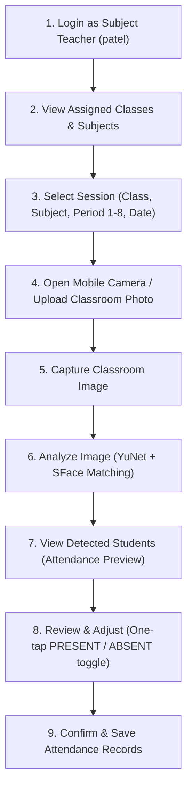

# One-Click Attendance System for Schools and Colleges Using Computer Vision

A full-stack, automated attendance system designed for modern schools and colleges. Instead of calling roll numbers one by one, teachers capture a single wide-angle photo of the classroom. The system uses Computer Vision and pre-trained face recognition embeddings to detect students, match them against enrolled student vectors, and present an attendance sheet for one-click verification and confirmation.

---

## 📌 Key System Features

1. **Admin Portal**: Institution-wide management of departments, faculty roles, student registry, and system analytics.
2. **Class Teacher Portal**: Monitor full-day section attendance, low attendance thresholds, and parent communication alerts.
3. **Subject Teacher Portal**: Period-wise subject attendance dashboard with one-click classroom photo capture.
4. **Student Management**: Student record creation with roll numbers, register numbers, and class sections.
5. **Face Enrollment**: Capture clear frontal student portraits and extract facial feature embeddings.
6. **Computer Vision Face Detection**: Detect multiple student faces in wide classroom group photographs.
7. **Face Recognition via Pre-trained Embeddings**: Compare detected face vectors against enrolled database vectors using Cosine/Euclidean similarity (no training neural networks from scratch).
8. **Classroom Photo-Based Attendance**: Process real classroom photos to flag present students automatically.
9. **Attendance Confirmation**: Human-in-the-loop review interface allowing teachers to visually verify and manually toggle students before saving.
10. **Attendance Reports**: Analytical reporting by student, class, subject, and date range with export support.

---

## 🏗️ Project Architecture

```
one-click-attendance/
│
├── backend/
│   ├── app/
│   │   ├── __init__.py
│   │   ├── main.py                     # FastAPI app, CORS, lifespan, routes & static files
│   │   ├── config.py                   # Pydantic Settings (.env configuration)
│   │   ├── database.py                 # SQLAlchemy engine, session maker, init_db
│   │   ├── models/                     # Database Models (SQLAlchemy ORM)
│   │   │   ├── __init__.py
│   │   │   ├── user.py                 # Users & Roles (Admin, Class/Subject Teachers)
│   │   │   ├── student.py              # Students & Face Embedding Vectors
│   │   │   └── attendance.py           # Attendance Sessions & Records
│   │   ├── schemas/                    # Pydantic Schemas (Request/Response validation)
│   │   │   ├── __init__.py
│   │   │   ├── user.py
│   │   │   ├── student.py
│   │   │   └── attendance.py
│   │   ├── api/                        # API Routers
│   │   │   ├── __init__.py             # Master API Router (/api/v1)
│   │   │   ├── auth.py                 # Authentication endpoints
│   │   │   ├── admin.py                # Admin dashboard metrics & faculty
│   │   │   ├── teachers.py             # Class Teacher & Subject Teacher endpoints
│   │   │   ├── students.py             # Student registration & face enrollment
│   │   │   └── attendance.py           # Photo processing, confirmation, reports
│   │   ├── services/                   # Business & CV Logic
│   │   │   ├── __init__.py
│   │   │   ├── face_service.py         # Face enrollment, quality validation & embeddings
│   │   │   ├── face_recognition.py     # Multi-face recognition & class-scoped matching
│   │   │   └── attendance_service.py   # Match processing pipeline
│   │   │   └── utils/                  # Helper utilities
│   │   ├── tests/                      # Automated test suites
│   │   │   ├── test_auth.py            # Authentication & RBAC tests
│   │   │   ├── test_class_teacher_portal.py
│   │   │   ├── test_admin_portal.py
│   │   │   ├── test_face_enrollment.py # Face enrollment pipeline tests
│   │   │   └── test_face_recognition.py# Computer Vision recognition tests
│   │   ├── requirements.txt            # Python dependencies
│   │   ├── .env.example                # Sample environment variables
│   │   └── .env                        # Active environment configuration
│
├── frontend/                           # Responsive Web Frontend (Bootstrap 5 + Vanilla JS)
│   ├── index.html                      # Unified portal dashboard
│   ├── css/
│   │   └── styles.css                  # Custom styling, dark sidebar, cards, pills
│   ├── js/
│   │   ├── api.js                      # API communication layer
│   │   └── app.js                      # UI routing, status checks, and form actions
│   └── assets/                         # Static assets
│
├── data/                               # Local file and model storage
│   ├── faces/                          # Enrolled individual student face photos
│   ├── attendance_photos/              # Uploaded classroom photos
│   └── models/                         # Pre-trained CV model weights (YuNet, SFace, etc.)
│
├── .gitignore                          # Git ignore rules
└── README.md                           # Documentation and instructions
```

---

## 🛠️ Technology Stack

- **Backend**: Python 3.10+, FastAPI, SQLAlchemy, SQLite (for local development), Pydantic v2
- **Frontend**: HTML5, Vanilla CSS3, JavaScript (ES6+), Bootstrap 5, Bootstrap Icons
- **Computer Vision**: OpenCV (`cv2`), NumPy, Pillow, with pre-trained face detection & embedding models (e.g. OpenCV YuNet + SFace)

---

## 🚀 How to Run Locally

### 1. Prerequisites
- Python 3.10+ installed on your system.
- Terminal / PowerShell.

---

### 2. Backend Setup & Startup

1. Open a terminal in the project directory:
   ```bash
   cd "one click attendance/backend"
   ```

2. (Recommended) Create and activate a Python virtual environment:
   - **Windows (PowerShell)**:
     ```powershell
     python -m venv venv
     .\venv\Scripts\Activate.ps1
     ```
   - **Linux / macOS**:
     ```bash
     python3 -m venv venv
     source venv/bin/activate
     ```

3. Install dependencies:
   ```bash
   pip install -r requirements.txt
   ```

4. Verify your `.env` file (one has already been generated from `.env.example`).

5. Run the FastAPI development server:
   ```bash
   uvicorn app.main:app --reload --host 127.0.0.1 --port 8000
   ```

6. Open your browser and test the backend:
   - **Root Status**: [http://127.0.0.1:8000/](http://127.0.0.1:8000/)
   - **Interactive Swagger Docs**: [http://127.0.0.1:8000/docs](http://127.0.0.1:8000/docs)
   - **Health Check**: [http://127.0.0.1:8000/health](http://127.0.0.1:8000/health)

---

### 3. Frontend Setup & Startup

You have two convenient ways to run the frontend:

#### Option A: Served directly by FastAPI (Easiest - Single Port)
The FastAPI backend automatically mounts the `frontend/` directory. Once the backend server is running:
- Open your browser to: **[http://127.0.0.1:8000/static/index.html](http://127.0.0.1:8000/static/index.html)**

#### Option B: Standalone Frontend Server
If you prefer running the frontend independently:
1. Open a new terminal in the `frontend` folder:
   ```bash
   cd "one click attendance/frontend"
   ```
2. Start Python's built-in HTTP server:
   ```bash
   python -m http.server 3000
   ```
3. Open your browser to: **[http://127.0.0.1:3000/](http://127.0.0.1:3000/)**

The frontend automatically detects the FastAPI backend at `http://127.0.0.1:8000` and displays the live **"Backend Online (FastAPI)"** status pill in the top header.

---

## 👁️ Computer Vision Face Recognition Service

The modular recognition engine is located at `backend/app/services/face_recognition.py`. It is completely decoupled from HTTP API routes, allowing direct usage by automated batch processes, API endpoints, and standalone test runners.

### 1. Models Used

The system leverages pre-trained OpenCV Deep Neural Network (DNN) ONNX models stored under `data/models/`:

| Component | Model Name | File | Description | Output |
| :--- | :--- | :--- | :--- | :--- |
| **Face Detection** | **YuNet** | `face_detection_yunet_2023mar.onnx` | Lightweight, fast deep CNN face detector (`cv2.FaceDetectorYN`). Robust to scale changes, head yaw/pitch, and uneven illumination. | Bounding box `[x, y, w, h]`, confidence score, and 5 facial landmarks (eyes, nose, mouth corners). |
| **Face Recognition** | **SFace** | `face_recognition_sface_2021dec.onnx` | Deep feature extractor (`cv2.FaceRecognizerSF`). Aligns the face crop to canonical landmarks and projects facial geometry into hypersphere space. | 128-dimensional float32 feature vector with unit $L_2$ norm ($\|v\|_2 = 1.0$). |

Both ONNX models are automatically downloaded on first boot into `data/models/` if not already present.

---

### 2. Similarity & Distance Calculation

Because SFace feature embeddings are $L_2$-normalized vectors ($\|u\|_2 = 1.0, \|v\|_2 = 1.0$), similarity is computed using **Cosine Similarity**:

$$\text{Cosine Similarity}(u, v) = \frac{u \cdot v}{\|u\|_2 \|v\|_2} = \sum_{i=1}^{128} u_i v_i \in [-1.0, 1.0]$$

Euclidean Distance relates directly to Cosine Similarity on the unit sphere:

$$\text{Euclidean Distance}(u, v) = \|u - v\|_2 = \sqrt{2 - 2 \cdot \text{Cosine Similarity}(u, v)}$$

---

### 3. Threshold Configuration & Decision Boundaries

The recognition threshold determines whether a detected face matches an enrolled student. It is fully configurable via:
- `.env` variable: `FACE_MATCH_THRESHOLD=0.60`
- Service constructor: `FaceRecognitionService(default_threshold=0.60)`
- Per-call override: `recognize_faces_in_image(..., threshold=0.65)`

#### Recommended Operating Ranges:

| Cosine Similarity | Status | `is_recognized` | `student_id` | System Action |
| :--- | :--- | :--- | :--- | :--- |
| **$\ge 0.85$** | `RECOGNIZED` | `True` | Assigned student ID | High-confidence match (same student portrait vs classroom face). |
| **$0.60 - 0.84$** | `RECOGNIZED` | `True` | Assigned student ID | Reliable match passing configurable threshold. |
| **$0.30 - 0.59$** | `LOW_CONFIDENCE` | `False` | `None` | **Never marked present!** Flagged for manual teacher inspection. |
| **$< 0.30$** | `UNKNOWN` | `False` | `None` | Face did not match any student in the enrolled class roster. |

> [!IMPORTANT]
> **Safety Guardrails**:
> 1. **Low-Confidence Protection**: Matches below the threshold are **never automatically marked as present**. They receive `is_recognized = False` and `student_id = None`.
> 2. **1-to-1 Match Disambiguation**: When multiple faces in the photograph resemble the same student above threshold, greedy descending similarity sorting assigns the student ID only to the highest similarity face. Subsequent faces default to `LOW_CONFIDENCE` / `UNKNOWN` to prevent multiple detections from claiming the same student.

---

### 4. Class Boundary Isolation (Strict Class Scoping)

To prevent false positive matches across different batches or sections:
- `FaceRecognitionService.load_enrolled_students_for_class(db, class_id)` filters strictly by `Student.class_id == class_id`, `Student.is_active == True`, and `Student.face_enrolled == True`.
- `FaceRecognitionService.recognize_faces_in_image(image_data, enrolled_roster)` compares detected faces **only against the enrolled roster of the designated class**.
- Even if a student from an unrelated class is clearly visible in the photograph, their face will be marked `UNKNOWN` with `student_id = None`.

---

### 5. Running the Unit Tests

The dedicated test suite verifies all model operations, multi-face detection, class isolation, and thresholding:

```bash
cd "one click attendance/backend"
python tests/test_face_recognition.py
```

Expected output:
```
================================================================================
ALL 9 UNIT TESTS PASSED SUCCESSFULLY!
================================================================================
```

---

## 📱 Subject Teacher Portal

The **Subject Teacher Portal** provides an intuitive, mobile-first responsive interface designed for faculty members taking period-wise attendance in active classrooms.

### 1. Step-by-Step Teacher Flow



1. **Login**: Authenticate as `SUBJECT_TEACHER` (e.g. username `patel`, password `teacher123`). The portal auto-redirects directly to the Subject Teacher section.
2. **View Assigned Classes & Subjects**: Accessible via the "My Assigned Classes & Subjects" tab or dynamic session dropdowns populated from `GET /api/v1/teachers/subject-teacher/classes`.
3. **Select Session Parameters**:
   - **Assigned Class**: Select the target class group (e.g., *CSE - 3rd Year - Section A*).
   - **Assigned Subject**: Select course curriculum (e.g., *CS302 - Computer Vision & Deep Learning*).
   - **Lecture Period**: Quick-select period chips (Period 1 through 8).
   - **Session Date**: Auto-initialized to today's date with datepicker override.
4. **Mobile Camera Access**:
   - **Browser Camera API**: Uses `navigator.mediaDevices.getUserMedia` configured with `{ facingMode: { ideal: "environment" } }` for rear mobile cameras.
   - Includes real-time camera viewfinder box, guideline overlay, and camera flipping (Front $\leftrightarrow$ Rear).
   - Instant frame grab using HTML5 `<canvas>` to generate high-resolution JPEG blobs.
   - **Fallback Gallery / File Upload**: Mobile-optimized file picker with `accept="image/*"` and `capture="environment"`.
5. **Classroom Image Analysis**:
   - Sends group photo to `POST /api/v1/attendance/analyze-classroom-photo`.
   - Runs OpenCV YuNet multi-face detection and SFace feature matching strictly isolated to the selected `class_id`.
6. **Attendance Preview (No Early Save)**:
   - **CRITICAL ARCHITECTURE**: Does **NOT** save attendance records immediately to the `attendance` table upon recognition.
   - Returns a structured preview with:
     - `present_count` & `absent_count`
     - Detected faces breakdown with AI match confidence percentages
     - Unknown or low-confidence face alerts
     - Full class roster mapped with `PRESENT` or `ABSENT` statuses
7. **Interactive Teacher Review**:
   - Faculty can inspect AI predictions.
   - One-tap toggle buttons (`Mark Present` / `Mark Absent`) with `is_manual: true` tracking.
   - Real-time search filter and batch buttons (`Mark All Present`, `Mark All Absent`).
8. **Attendance Confirmation**:
   - Submitting `POST /api/v1/attendance/confirm` permanently writes verified records to the `attendance` table.
   - Built-in upsert ensures idempotency (updating existing records without duplicates).

---

### 2. Two-Step Attendance API Architecture & Visual Pipeline

The system strictly decouples image analysis from attendance persistence to ensure a human-in-the-loop workflow:

| Endpoint | Method | Purpose | Database Effect |
| :--- | :--- | :--- | :--- |
| `POST /attendance/analyze`<br>*(alias: `/api/v1/attendance/analyze-classroom-photo`)* | `POST` | Validates photo, runs YuNet multi-face detection & SFace embeddings, queries enrolled embeddings **strictly for selected class**, matches reliable identities, generates annotated image with bounding boxes & names. | Saves raw photo & annotated photo to `data/attendance_photos/`. **0 records added to `attendance` table (preview only).** |
| `POST /attendance/confirm`<br>*(alias: `/api/v1/attendance/confirm`)* | `POST` | Validates payload against duplicate student entries (HTTP 400). Persists teacher-confirmed records. | Upserts into `attendance` table respecting unique constraint `(student_id, class_id, subject_id, date, period)`. |

#### Example Result Breakdown:
```json
{
  "total_students_in_class": 50,
  "total_faces_detected": 43,
  "recognized_count": 41,
  "unknown_count": 2,
  "present_count": 41,
  "absent_count": 9,
  "annotated_image_url": "/attendance_photos/annotated_classroom_20261005_120000.jpg",
  "preview_records": [
    {
      "student_id": 1,
      "roll_number": "CS-01",
      "full_name": "Alex Chen",
      "status": "PRESENT",
      "confidence": 88.5,
      "bounding_box": [120, 85, 90, 110]
    }
  ]
}
```

> [!NOTE]
> **Duplicate Prevention Rule**:
> - Payloads attempting to mark the same student multiple times for the same class, subject, date, and period are rejected with **HTTP 400 Bad Request**.
> - Database integrity is enforced at the schema level via `UniqueConstraint("student_id", "class_id", "subject_id", "date", "period", name="uq_attendance_student_session")`.
> - Re-confirming a session performs an idempotent upsert, updating existing records without generating duplicate rows.

---

### 3. Running the Subject Teacher Portal Automated Tests

```bash
cd "one click attendance/backend"
python tests/test_subject_teacher_portal.py
```

Expected output:
```
===========================================================================
STARTING SUBJECT TEACHER PORTAL END-TO-END AUTOMATED VERIFICATION
===========================================================================
[PASS] Logged in as: Prof. R. Patel (Role: SUBJECT_TEACHER)
[PASS] Retrieved 1 assigned classes, 1 assigned subjects
[PASS] PREVIEW INTEGRITY VERIFIED: Attendance table row count remained 5 (no early save).
[PASS] Annotated classroom image with bounding boxes & names generated: /attendance_photos/annotated_classroom_alex_priya.jpg
[PASS] Analysis returned 5 student previews: 2 Present, 3 Absent, 2 Faces detected in photo
[PASS] Duplicate student entry in confirmation payload rejected with HTTP 400
[PASS] Successfully confirmed and persisted 5 attendance records
[PASS] Idempotency / Upsert verified: Record count remained 5 without duplicates
[PASS] Report reflects session: Total records=6, Present=4
[PASS] Unauthenticated access to /attendance/analyze-classroom-photo blocked with HTTP 401

---

## Role-Specific Attendance Dashboards & Visual Analytics

Interactive, responsive dashboards powered by Chart.js 4 and FastAPI:

### 1. Class Teacher Dashboard (`/attendance/dashboard/class-teacher`)
- **Today's Attendance**: Real-time donut chart showing Present vs Absent, period-by-period attendance badges, and today's overall rate.
- **Class Attendance Percentage**: Circular gauge card showing overall cohort rate (&ge;75% indicator), total students, sessions conducted, and records marked.
- **Student-wise Attendance**: Full table showing roll numbers, face enrollment status, attended/absent sessions, individual rates, and low-attendance alert badges (&lt;75%). Live instant search and status filter.
- **Subject-wise Attendance**: Comparison bar chart and table displaying attendance rates, assigned faculty, and total sessions across every subject taught to the class.
- **Date-wise Attendance**: Daily timeline trend line chart showing attendance variations across dates, with complete tabular sessions ledger.

### 2. Subject Teacher Dashboard (`/attendance/dashboard/subject-teacher`)
- **Attendance Taken by Them**: Faculty summary KPIs (sessions taken, total records, present count) with a status donut chart.
- **Class-wise Records**: Bar chart and summary table comparing attendance performance across different class sections taught by the teacher.
- **Subject-wise Records**: Bar chart and breakdown table showing attendance performance across distinct course subjects.
- **Date-wise Records**: Timeline line chart and recent sessions ledger with class, subject, period, present/absent counts, and verified status.

### 3. Admin Dashboard (`/attendance/dashboard/admin`)
- **All Classes**: Institutional bar chart and table comparing all cohort classes, class teachers, records marked, and standing status.
- **All Subjects**: Curriculum bar chart and table showing attendance rates, classes linked, and faculty assignments.
- **Attendance Statistics**: KPI cards (total sessions, institutional rate, present/absent counts, today's rate, active faculty) + Status Breakdown Donut & Institutional Daily Timeline Line Chart.
- **Teacher Attendance Activity**: Ranked faculty activity bar chart and table displaying sessions taken, records marked, subjects handled, and last active dates.

### 4. Interactive Universal Filters
All dashboards support 5 dynamic filters:
1. `class` (`class_id`): Filter by academic cohort / section.
2. `subject` (`subject_id`): Filter by curriculum subject / course.
3. `student` (`student` / `student_id`): Freeform search by student roll number, register number, or full name, or integer ID.
4. `teacher` (`teacher_id`): Filter by faculty member.
5. `date range` (`start_date` & `end_date`): Filter across custom historical timeframes.

### 5. Running Comprehensive Dashboard Tests

```bash
python test_comprehensive_dashboard.py
```

Expected output:
```
=== STARTING COMPREHENSIVE ATTENDANCE DASHBOARD VERIFICATION ===
[1] Testing Admin Attendance Dashboard (/attendance/dashboard/admin)...
  [PASS] Admin default: 200 OK
  [PASS] Admin filter class_id=1: 200 OK
  [PASS] Admin filter subject_id=1: 200 OK
  [PASS] Admin filter teacher_id=3: 200 OK
  [PASS] Admin filter student='21CS001': 200 OK
  [PASS] Admin filter date range: 200 OK
  [PASS] Admin combined filters: 200 OK
[2] Testing Class Teacher Attendance Dashboard (/attendance/dashboard/class-teacher)...
  [PASS] Class Teacher default: 200 OK
  [PASS] Class Teacher filter subject_id=1: 200 OK
  [PASS] Class Teacher filter student_id=1: 200 OK
  [PASS] Class Teacher filter student='Sharma': 200 OK
  [PASS] Class Teacher filter teacher_id=3: 200 OK
  [PASS] Class Teacher filter date range: 200 OK
[3] Testing Subject Teacher Attendance Dashboard (/attendance/dashboard/subject-teacher)...
  [PASS] Subject Teacher default: 200 OK
  [PASS] Subject Teacher filter class_id=1: 200 OK
  [PASS] Subject Teacher filter subject_id=1: 200 OK
  [PASS] Subject Teacher filter student='21CS001': 200 OK
  [PASS] Subject Teacher filter date range: 200 OK
SUCCESS: ALL 18 DASHBOARD AND FILTER TESTS PASSED SUCCESSFULLY!
```
```

